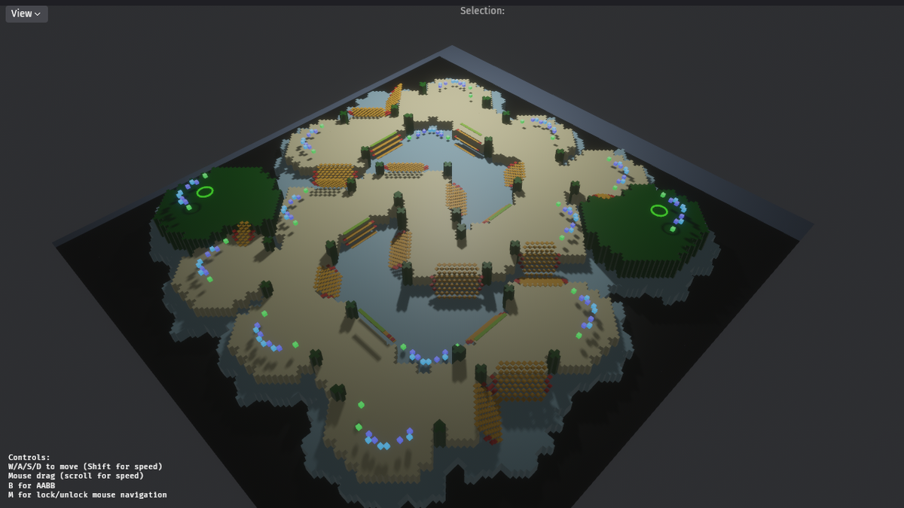
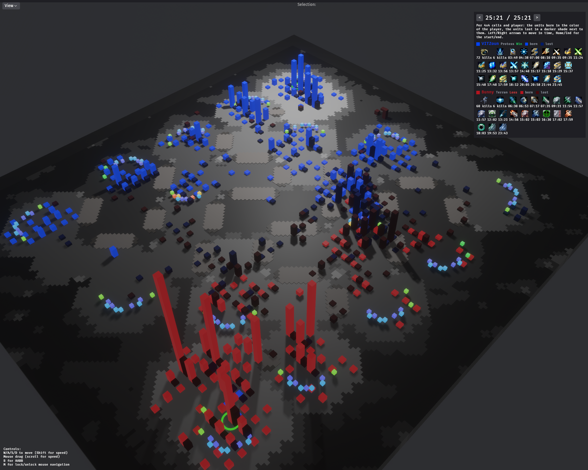

# Bevy Starcraft 2 Map viewer for the Swarmy project

## Status

MapInfo, T3 Height Map, Objects (Units such as XelNagaTowers, Doodas, UnitPoints such as StartLocations)





The replay bars are per 4x4 cells and player, the units born in the color of the player and the
units lost in a darker shade next to them. swarmy's
[walkthrough](https://github.com/sebosp/swarmy#walkthrough) shows it opened from a replay.

The replays are managed via [swarmy](https://github.com/sebosp/swarmy)
Once a replay path is defined, the caches can be downloaded, the maps listed and the preview from this repo is triggered.

### Replays

`--replay <file.SC2Replay>` shows the replay on its map, the replay has the cache handles of the map
so only `--path` (the cache path) is needed. swarmy runs it from the Replay List and Replay Detail.

- The terrain is flattened, keeping the colors of its levels.
- Every 4x4 map cells have a green bar for the units born (UnitBorn and UnitInit) and a red bar for
  the units died up to the current time, only the units that cost resources (no Larva, Broodlings,
  etc). The bars are scaled by the cell with the most units in the game, so they grow over time.
- The time moves in steps of 30 seconds with the `<` `>` buttons or the Left/Right arrows, Home/End
  for the start and the end of the game. `--replay-seconds <seconds>` starts at a given time.
- The players panel has each player in their color, the clan tag unescaped (`<TAG> Player`), the
  race and the result, the upgrades finished so far with their button textures and times, and the
  most effective unit (most enemy units killed so far) and ability (the ability most of the killer
  units were last commanded, besides move, attack, etc). Hover an icon for its name, click a bar for
  its counts.

The button textures are embedded by s2protocol (the `textures` feature).

```bash
cargo run -- --path ~/SC2Replays/swarmy --replay "Celestial Enclave LE.SC2Replay" --replay-seconds 600
```

### Ramps

The ramps of t3Terrain.xml are drawn with the ramp algorithm of
[sc2-map-analyzer](https://github.com/sebosp/sc2-map-analyzer) (`SC2Map::processRamp`), ported in
`src/t3_terrain/ramp_cells.rs`: from the direction and the `leftLo`/`rightLo` corners of each ramp,
the cells across the ramp are walked from one corner to the other. The ramp cells (pathable, not
buildable) are drawn in amber going up from the low ground to the high ground, the top row of the
straight ramps (pathable and buildable, where the walls are placed) in lime and the sides of the
ramps (not pathable) in red.

### View menu

The View menu shows or hides the ObjectDoodads, the ObjectUnits (mineral fields, geysers, rocks,
towers), the ObjectPoints (start locations, no fly zones) and the ramps. Clicking on any of them
shows its name in the Selection.

### Screenshots

`--screenshot <file.png>` saves a screenshot once the map is loaded and exits, to check the
rendering, i.e. after changing how the assets are loaded. On Wayland the compositor may not render
a window that is not visible, `WAYLAND_DISPLAY= ` runs it with XWayland.

```bash
cargo run -- --path ~/SC2Replays/swarmy --ids <cache ids> --screenshot /tmp/map.png
```

swarmy-bevy uses s2protocol 3.6.0 from crates.io, which reads the ramp directions and levels from
t3Terrain.xml and embeds the button textures (the `textures` feature).

swarmy-bevy uses Bevy 0.20 and bevy_skein 0.7 (a release candidate, the first version for Bevy
0.20).

## TODO:

- Draw the ramps as sloped surfaces instead of tiles at each step.
- The NoFlyZones should be removed and thoughts on making them toggled in a minimal UI.
- Through the generated snapshots generated by swarmy, we can query the Apache Arrows files and generate statistics that can be 3D shapes in the map.
- A replay timeline slider instead of the 30 seconds steps, and the units alive at each time.
- The most effective ability uses the last command of the killer unit, abilities like Psionic Storm
  or Fungal Growth that kill through an effect are better measured by the kills shortly after the
  command.

## Sources:

Thanks to [sc2-map-analyser](https://github.com/jnmaloney/sc2-map-analyzer) 

## Initial setup

```bash
rustup target add x86_64-pc-windows-gnu
rustup target add x86_64-apple-darwin
cargo install xwin
cd ~/ # Otherwise cross-device link issues
xwin --accept-license splat --disable-symlinks --output ~/.xwin
```

## Bundling with swarmy

Swarmy runs swarmy-bevy as a Tauri sidecar, which must be named `swarmy-bevy-<target triple>`.
The Blender/Skein scene (`assets/swarmy-objects.gltf` and `.bin`) is embedded in the binary, so
the sidecar does not need an `assets` directory next to it.

```bash
# Builds the release binary without the dev features and copies it to swarmy's assets.
cargo run --bin tauri-sidecar -- ../swarmy/assets
# Other targets, i.e. Windows, after the initial setup above.
cargo run --bin tauri-sidecar -- ../swarmy/assets x86_64-pc-windows-gnu
```

### Releases

`.github/workflows/sidecar.yaml` builds the sidecar for Linux (x86_64, aarch64), Windows (x86_64)
and macOS (Apple Silicon, Intel), named `swarmy-bevy-<target triple>[.exe]`. Pushing a `v*` tag
creates a GitHub release with them, swarmy's `scripts/download-sidecars.sh` downloads the one of
the platform, the pull requests to main build them without releasing them. `ci.yaml` checks the
formatting, Clippy lints, documentation and tests.

`build.rs` provides the target triple. It cannot copy the binary itself because build scripts run
before the binary is compiled.
